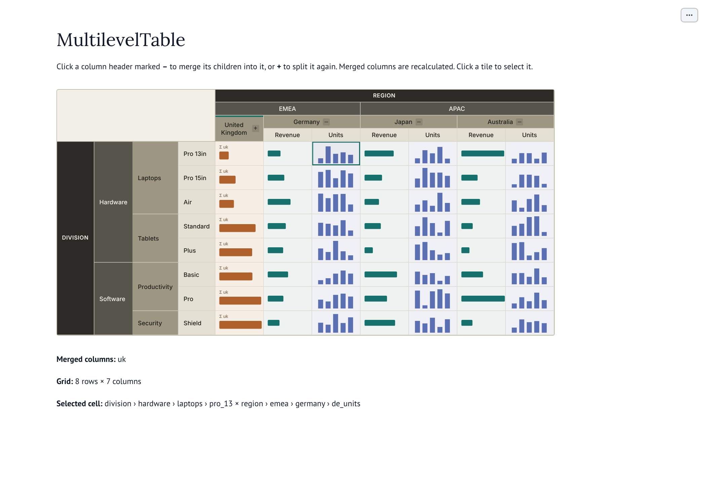

# MultilevelTable

An [anywidget](https://anywidget.dev) for [marimo](https://marimo.io): a grid of
uniform SVG tiles under a **mergeable column hierarchy**, with a fixed
hierarchy of row headers down the left.

Click a column group to **merge** its children into one column; click it again
to **split** them back out. Every tile is drawn by a `calculate(row_path,
col_path)` function you supply, so merged columns are recalculated as one
summary. Click a tile to select it; the selection is available to downstream
marimo cells.

**[Open the demo in molab](https://molab.marimo.io/github/jimbobcuz/multilevel-table/blob/main/demo_standalone.py)**
(runs in the browser; nothing to install).



---

## Quick start

```python
import marimo as mo
from multilevel_table import H, MultilevelTable

cols = H("Region", [
    H("EMEA", [
        H("UK", [H("Revenue", key="uk_rev"), H("Units", key="uk_units")], key="uk"),
        H("Germany", [H("Revenue", key="de_rev"), H("Units", key="de_units")], key="germany"),
    ], key="emea"),
], key="region")

rows = H("Division", [
    H("Hardware", [H("Laptops", key="laptops"), H("Tablets", key="tablets")], key="hardware"),
], key="division")

def calculate(row_path, col_path):
    # row_path ["division", "hardware", "laptops"]
    # col_path ["region", "emea", "uk", "uk_rev"]  — or ["region", "emea", "uk"] once UK is merged
    return "<svg viewBox='0 0 96 48'><rect width='96' height='48' fill='#16706b'/></svg>"

table = MultilevelTable(rows, cols, calculate, cell_width=96, cell_height=48)
widget = mo.ui.anywidget(table)   # wrap it so marimo tracks it
widget
```

In a later cell:

```python
widget.value["col_merged"]   # ["uk"]
widget.value["selected"]     # {"row": [...keys], "col": [...keys]} or None
```

`widget.value` is a dict of every synced trait, and any cell that reads it
re-runs when the user merges, splits or selects.

---

## What the user can do

| Action | Where | Result |
| --- | --- | --- |
| Merge | Column header marked **–** | Its children collapse into one column; tiles recalculate |
| Split | Column header marked **+** (accent bar on top) | Children reappear in the state they were in |
| Select | Any tile | Tile is outlined; `selected` holds its row and column paths. Click again to clear |

Row headers have no controls. Headers can't be renamed from the UI;
`table.relabel(key, label)` does it from Python.

---

## Merge rules

A column node can be merged only when **all its direct children are currently
leaves**, so merges go bottom-up: merge UK and Germany before EMEA. A merged
node keeps its children, so splitting restores them exactly, including any that
were themselves merged.

---

## Cell content

`calculate(row_path, col_path)` is called once per tile on every change. Paths
are lists of node keys from the root to the current leaf; a merged column's
path stops at the merged node.

| Return value | Shown as |
| --- | --- |
| A string starting with `<svg` | The SVG, filling the tile (the `xmlns` is added if you leave it off) |
| A number or other text | Centred text |
| `None` | A faint dot |
| Anything else | `str(value)` as text |

**Make the SVG fill the tile:** give it a `viewBox` with the tile's shape
(`0 0 96 48` for the default size), or add `preserveAspectRatio='none'`. A
square `viewBox` in a 2:1 tile is letterboxed, which is standard SVG behaviour.

The SVG is inserted as trusted markup. Only return SVG your own code generates.

---

## API

### `H(label, children=None, *, key=None)`

Builds a header node. Supply explicit `key`s; they appear in paths, in
`col_merged`, and in `merge` / `split` calls.

### `build_forest(fields)`

`from multilevel_table.fields import Field, build_forest` builds a regular
cross-product hierarchy from a list of `Field(name, members, start_merged=False)`.

### `MultilevelTable(row_headers, col_headers, calculate=None, *, cell_width=96, cell_height=48)`

| Method | Effect |
| --- | --- |
| `merge(key)` / `split(key)` | Merge or split a column header. Raises for row keys or invalid states |
| `relabel(key, label)` | Rename any header |
| `select(row_key, col_key)` | Select the tile at a row leaf and a column leaf |
| `clear_selection()` | Clear the selection |

| Synced trait | Contents |
| --- | --- |
| `col_merged` | Keys of merged column nodes (the browser sets this) |
| `selected` | `{"row": path, "col": path}` or `None` (the browser sets this) |
| `row_paths`, `col_paths` | Paths of the current leaves, in display order |
| `data` | `R × C` list of `calculate` results |
| `cell_width`, `cell_height` | Tile size in pixels; change them live |
| `col_grid`, `row_grid` | Header span cells, used by the renderer |

---

## How it works

Python owns all state. The browser changes only two traits, `col_merged` and
`selected`, using `model.set` + `save_changes` (the path marimo watches). Python
observes them, applies the merges in a safe order, recomputes the header spans
and every tile, and syncs the result back. Invalid requests are dropped and the
true state is written back.

The renderer is one CSS Grid. Header tracks size to their content (column
labels wrap); data tracks are exactly `cell_width × cell_height`, so every tile
is the same size whatever is merged. Each header cell is placed on grid lines
straight from `spans.py`. Header rows and columns stay pinned while scrolling.

| Module | Role |
| --- | --- |
| `header.py` | `HeaderNode` tree; merge / split / relabel rules |
| `spans.py` | Grid position and span of every header cell |
| `fields.py` | Cross-product hierarchies from fields |
| `widget.py` | The anywidget: traits, observers, `calculate` pass |
| `examples.py` | Development hierarchy and example SVG tiles |
| `static/widget.js`, `widget.css` | CSS Grid renderer; no external requests |

---

## Run the demo

```bash
pip install -e . marimo
marimo edit demo.py          # or ./demo.py with uv installed
```

`demo_standalone.py` is the same notebook with the package inlined, for
[molab](https://molab.marimo.io/github/jimbobcuz/multilevel-table/blob/main/demo_standalone.py)
or anywhere without the package installed. See `RUNNING_IN_MOLAB.md`.

---

## Tests and checks

```bash
pip install pytest playwright
python -m pytest multilevel_table/tests -q        # 146 tests

# Real widget.js driven against the real Python widget in headless Chromium
python scripts/browser_check.py /tmp/mlt-check

# Live round trip through a real marimo server
marimo run demo.py --headless --port 2799 --no-token &
python scripts/marimo_live_check.py http://localhost:2799 /tmp/mlt-live
```

The last check clicks a header and a tile in a running marimo app and confirms
the table and the downstream cell both update.

---

## Not built yet

- Semantic zoom (shrink row height while column headers stay full size)
- Drag-and-drop field selector, to be designed separately
- Row merging and group / ungroup
